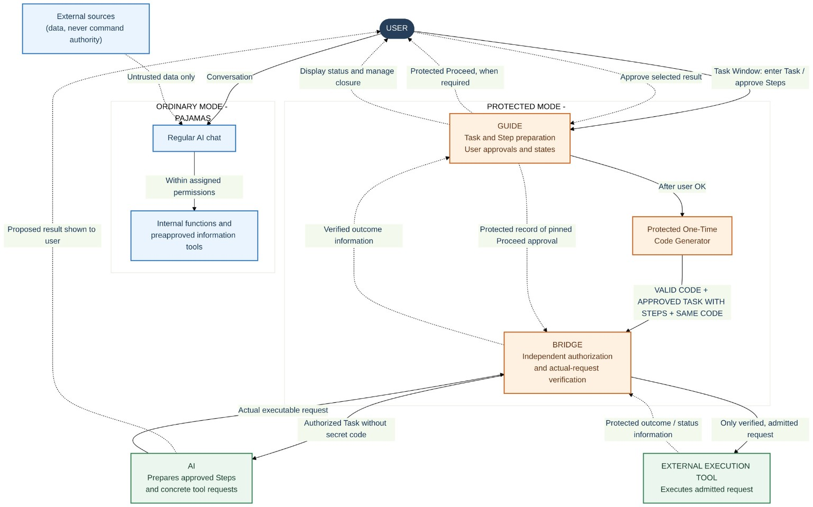
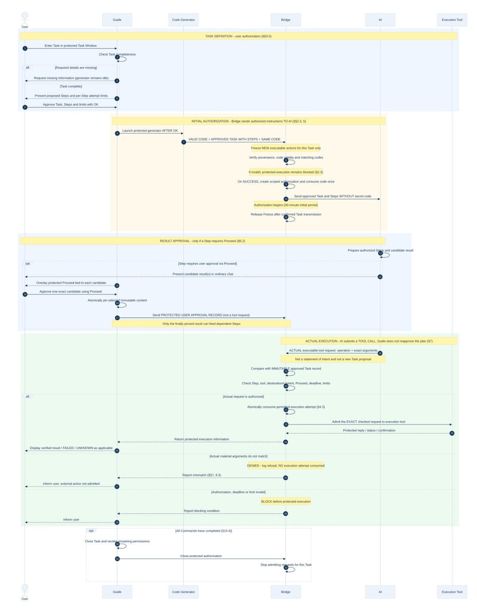
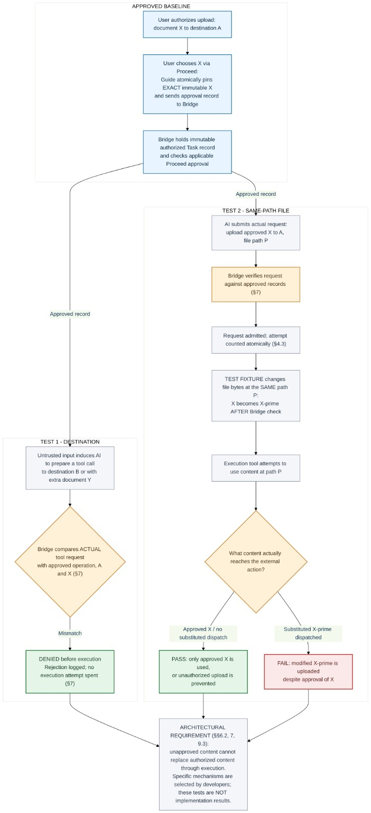

# NovaC.O.D.E.forAI: From Architecture to a Python Research Prototype

Following the publication of the original NovaC.O.D.E.forAI architecture, I am presenting the second version of the project, which now includes a Python research reference implementation, technical documentation, and reproducible test results.

> **Repository scope:** This GitHub repository is a selective technical overview with authentic excerpts from the published Python tests and the original diagrams. It is **not** a standalone runnable copy of the research prototype. The complete, reproducible research build is available through the [official V2 Zenodo publication](https://doi.org/10.5281/zenodo.23841706).

## A Brief Introduction to NovaC.O.D.E.forAI

NovaC.O.D.E.forAI (Command Outfit & Dresscode Etiquette) proposes an architectural approach to independent user authorization and controlled execution of AI actions.

Its central principle is simple: **information received by an AI must not automatically become a source of authority to issue commands to it.**

The architecture distinguishes between ordinary permitted interactions and protected external actions that require explicit authorization.

### Figure 1. NovaC.O.D.E.forAI — Architectural Overview



[View the original Mermaid source](01_Architectural_Overview_EN.mmd).

### Pajamas and Dress Code — Two Modes of Interaction

This distinction is illustrated by the project's **"Pajamas and Dress Code"** metaphor.

In **Ordinary Mode ("Pajamas")**, the AI can communicate, analyze information, prepare content, and use permitted informational services without requiring protected task authorization.

In **Protected Mode ("Dress Code")**, protected external actions require explicit user authorization and must remain within the approved Task, parameters, permissions, and execution limits.

The purpose is to preserve ordinary interaction while preventing untrusted information or AI-generated instructions from independently authorizing protected actions.

### Figure 2. Authorization and Execution Sequence



[View the original Mermaid source](02_Execution_Sequence_Clarified_EN.mmd).

### Guide and Bridge — Independent Authorization and Execution Control

Two independent systems are proposed:

- **Guide** manages user-facing task preparation, authorization, step sequencing, approvals, and execution limits.
- **Bridge** independently verifies actual executable requests against the approved task, parameters, permissions, and constraints before allowing protected execution.

Actions outside the granted authority are denied by default.

## From Architecture to Research Code

A Python research prototype has been developed to implement and examine selected mechanisms of NovaC.O.D.E.forAI.

The published research build includes **100 local test scenarios**, covering authorization controls, request validation, execution limits, authorization time extensions, and content integrity.

Among them are two particularly important security tests.

### Figure 3. Two Adversarial Test Scenarios Proposed by vitayao



[View the original Mermaid source](03_Substitution_Test_Fixtures_Clarified_EN.mmd).

### TEST 1 — Unauthorized Destination or Content Substitution

The tests attempt to change an approved destination from A to B or add an unauthorized document Y. The simulated Bridge rejects these mismatches before execution.

**Authentic Python test excerpts** from `tests/test_snapshot_integration.py` in the official V2 archive:

```python
def test_destination_b_is_denied_before_dispatch(self):
    with self.assertRaises(AuthorizationDenied):
        self.permit(parameters={"destination": "B", "file_path": "P"})
    self.assertEqual(self.bridge.attempt_count(self.task.task_id, "upload"), 0)
    self.assertEqual(self.executor.sent, [])
    self.assertTrue(any(e.get("event") == "REQUEST_REJECTED" for e in self.bridge.events()))

def test_extra_unapproved_document_y_is_denied_before_dispatch(self):
    with self.assertRaises(AuthorizationDenied):
        self.permit(parameters={"destination": "A", "file_path": "P", "extra_documents": [Y.hex()]})
    self.assertEqual(self.bridge.attempt_count(self.task.task_id, "upload"), 0)
    self.assertEqual(self.executor.sent, [])
```

Both cases verify denial before dispatch, with **zero execution attempts consumed** and no simulated external request sent.

### TEST 2 — Same-Path File Replacement (TOCTOU)

This test replaces approved file content X with modified content X′ at the same file path after authorization checks.

The initial research implementation exposed a weakness in this scenario. A snapshot-based mechanism was subsequently integrated to preserve the exact approved bytes through the simulated execution boundary.

In the final research build, the test executor receives the approved content X rather than the substituted content X′.

**Authentic Python test excerpt** from the same published test module:

```python
def test_same_path_replacement_after_bridge_check_still_sends_x(self):
    permit = self.permit()
    with tempfile.TemporaryDirectory() as td:
        path = Path(td) / "P"
        path.write_bytes(X)
        observed_path = []

        def replace_after_dispatch(_permit):
            path.write_bytes(X_PRIME)
            observed_path.append(path.read_bytes())

        result = self.executor.execute(permit, before_snapshot_read=replace_after_dispatch)
        self.assertEqual(observed_path, [X_PRIME])
        self.assertEqual(path.read_bytes(), X_PRIME)
    self.assertEqual(result["payload_digest"], hashlib.sha256(X).hexdigest())
    self.assertEqual(self.executor.sent_snapshots[-1], X)
    self.assertNotEqual(self.executor.sent_snapshots[-1], X_PRIME)
```

Here, `X` and `X_PRIME` are fixed test byte sequences. The test uses the full V2 fixture (`self.permit`, the simulated `Bridge`, and `FakeExecutor`). It is an excerpt for inspection and is **not runnable by itself**. It makes no real file upload or external API call.

The test confirms that the file at the original path has been modified to X′, while the simulated executor still receives the originally approved content X.

**Special thanks to vitayao, a member of the OpenAI Developer Forum, for proposing these two test scenarios.** They prompted additional investigation and validation, helped expose a weakness in the initial research implementation, and contributed to the development and testing of the improved content-integrity mechanism.

The complete suite of **100 tests passed in repeated local runs**. Test records, the complete source code, and implementation documentation are included in the published [V2 archive](https://doi.org/10.5281/zenodo.23841706).

## Scope and Limitations

**This prototype is not connected to an operational AI system.**

It is a standalone research implementation designed to evaluate selected architectural mechanisms under controlled conditions.

Full integration would require access to the target AI system's architecture, internal interfaces, protected components, and tool-execution mechanisms.

Successful local testing does not establish production readiness or independently verified security of a deployed AI system.

The snapshot mechanism is an engineering solution chosen for this research implementation, not a specific technology mandated by the original architectural document.

## Publications

**V1 — Original Architecture (October 25, 2026)**

https://doi.org/10.5281/zenodo.23645181

**V2 — Architecture and Python Research Reference Implementation**

https://doi.org/10.5281/zenodo.23841706

The original architectural PDF remains unchanged and serves as the authoritative source of architectural requirements. V2 supplements it with the research implementation, source code, tests, and accompanying documentation.

Both publications are available through Zenodo, the official source of record for published versions of NovaC.O.D.E.forAI.

## Rights and License

Copyright © 2026 Amira Akhunova. All rights reserved.

The Python research implementation and these excerpts are subject to the [NovaC.O.D.E.forAI Research Evaluation License](LICENSE). This is a **source-available research license**, not an Open Source license. Public access does not grant unrestricted reuse, redistribution, or commercial rights.

The original architectural PDF retains its separate rights and terms, as described in the official publication.
